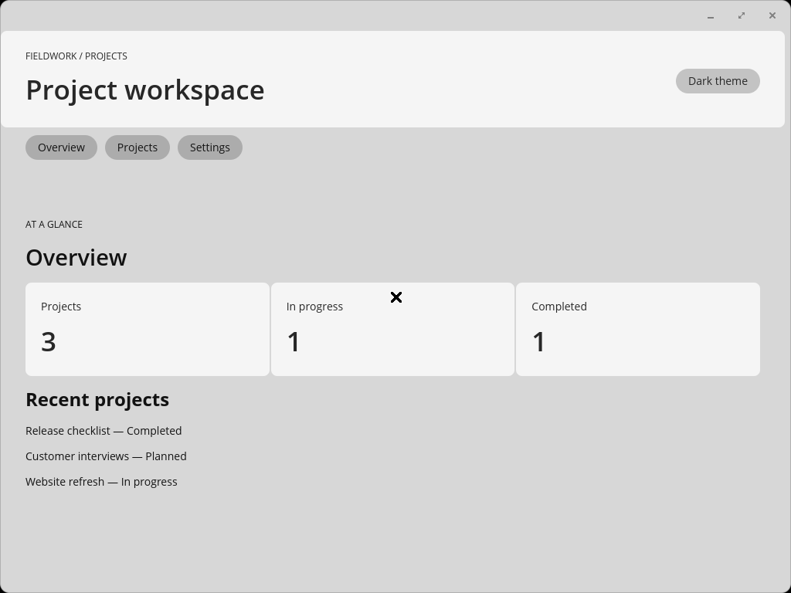

# Project workspace — COSMIC

Native project workspace with overview, projects and settings pages. Add, edit, search, filter and delete projects; adjust progress, change list density and switch themes. Projects and settings are saved under `XDG_DATA_HOME/rupicola-examples` (or `~/.local/share/rupicola-examples`). No protocol instrumentation is embedded. This exercises selected widgets, not the full framework catalogue.

## Dependencies and execution

Rust 1.99.1, Cargo, a Linux graphical session, and development libraries for X11 or Wayland are required. Cargo resolves the pinned framework and dependencies. Run `cargo run` from this directory.

## Preview

The recording shows the initial page; the X11 capture backend does not automate interactions.

After building, regenerate media from the repository root with `cargo run -p example-capture -- workspace --framework cosmic --binary /absolute/path/to/cosmic-project-workspace`. Requires Xvfb and FFmpeg; capture uses X11.
