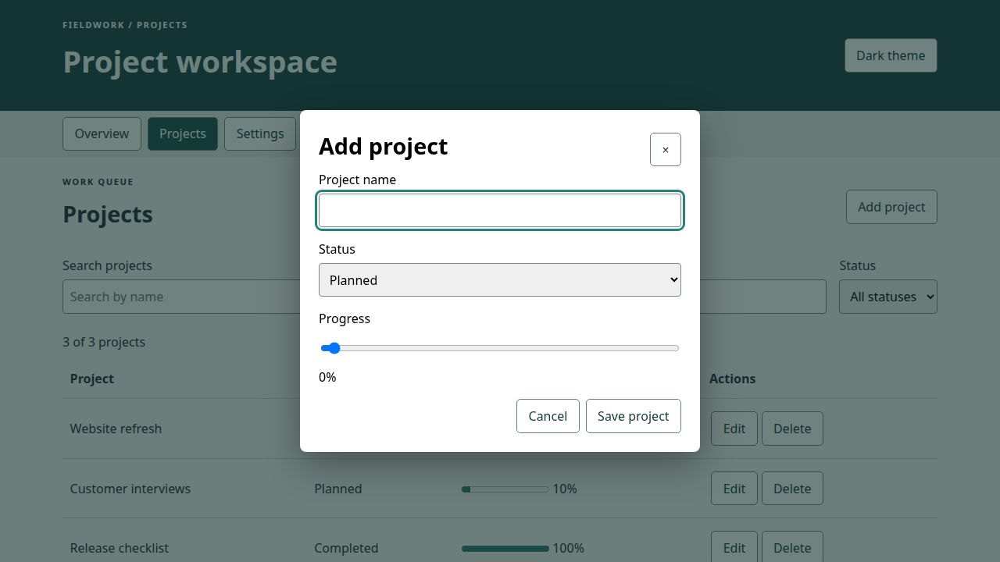
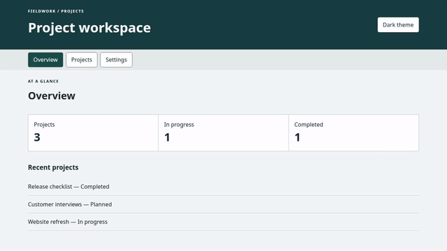

# Project workspace — HTML

A multi-page-style project workspace using native HTML, CSS and JavaScript. Includes navigation, search and status filtering, create/edit/delete dialogs, progress controls, settings, theme switching, local persistence and responsive layout. No Rupicola code is embedded.

## Dependencies and execution

A modern browser and a static HTTP server are required. From this directory run `python3 -m http.server 8080`, then open `http://localhost:8080`. Project data is stored in the browser's local storage.

This exercises a range of native HTML elements; it is not a complete catalogue of all HTML elements.

## Preview

To regenerate, run `cargo run -p example-capture -- workspace --framework html` from the repository root. The tool serves the page and writes to this directory’s `media/` automatically. Playwright, Chromium and FFmpeg must be available; set `RUPICOLA_PLAYWRIGHT_DIR` to the Playwright module path.
