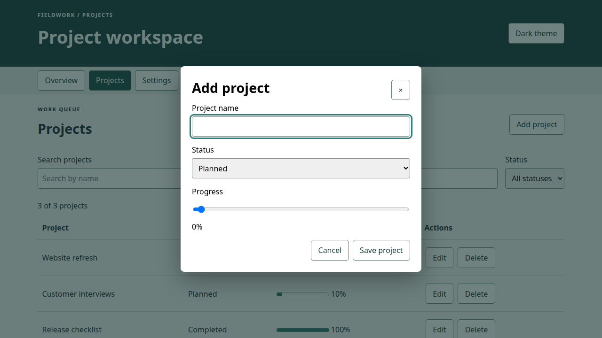

# Project workspace — React

A React 19 workspace with overview, project management and settings pages. Includes search and status filtering, create/edit/delete dialogs, progress controls, theme switching, responsive layout and local persistence. No Rupicola code is embedded.

## Dependencies and execution

Node.js 20.19+ or 22.12+, npm and a modern browser are required. In this directory run `npm ci` and `npm run dev`; Vite prints the local address. Run `npm run build` for a production build. Data stays in browser local storage.

This exercises a selection of React and browser UI features; it is not a complete component catalogue.

## Preview

To regenerate, serve the application and run `cargo run -p example-capture -- workspace --framework react --url http://127.0.0.1:5173` from the repository root. Playwright, Chromium and FFmpeg must be available; set `RUPICOLA_PLAYWRIGHT_DIR` to the Playwright module path.
