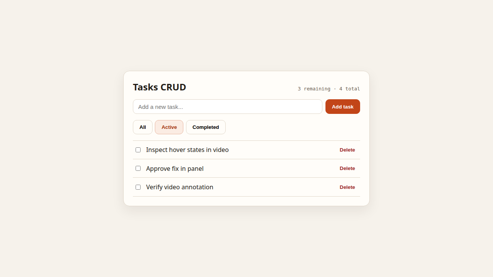
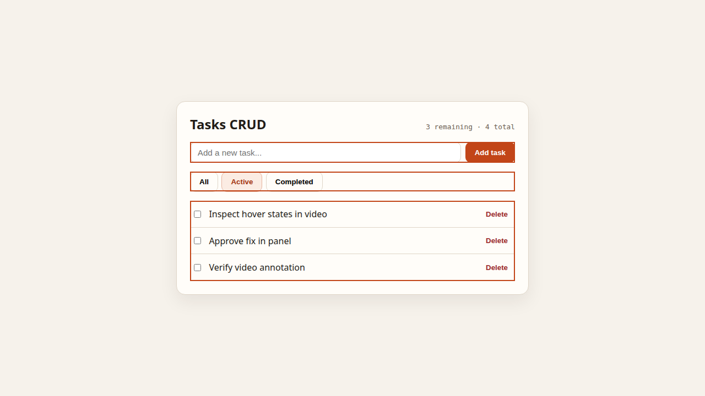
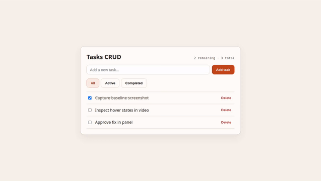
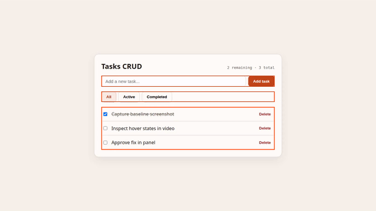

# Tasks CRUD (`examples/apps/crud-tasks`)

> Language: **English** | [Português (BR)](README.pt-BR.md)

Classic task-list CRUD application demonstrating form submission, state filters (`All` / `Active` / `Completed`), checkboxes, item removal, and empty states without any Rupicola instrumentation in the app source.

## How to run

```sh
python3 -m http.server 8080 --directory protocol/examples/apps/crud-tasks
```

Open `http://127.0.0.1:8080` in your browser.

## Captured Media





- Interactive walkthrough video (clean): [walkthrough.mp4](media/walkthrough.mp4)
- Interactive walkthrough video (annotated): [walkthrough-annotated.mp4](media/walkthrough-annotated.mp4)




