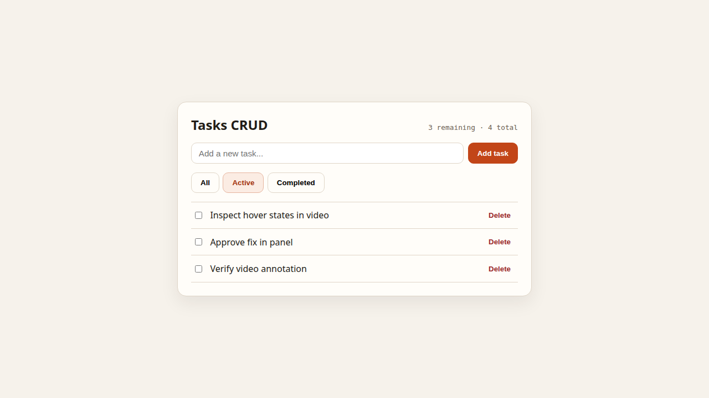
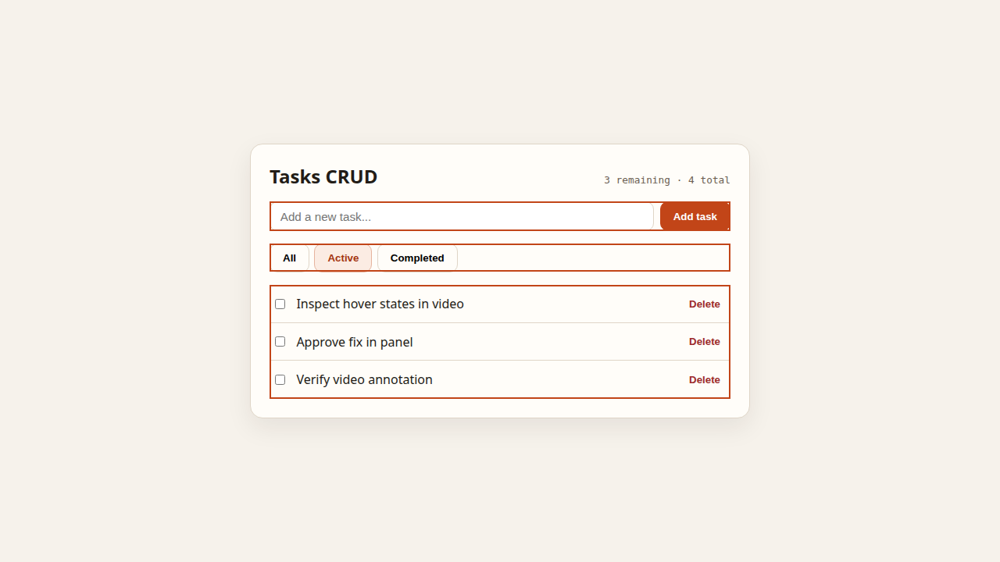
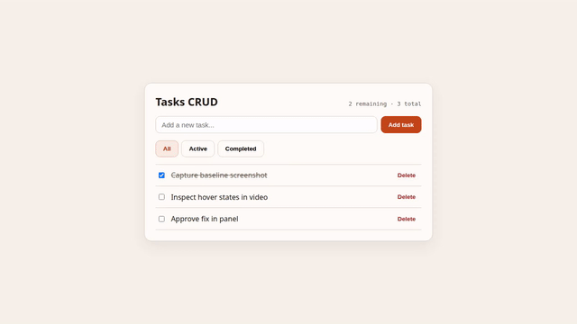
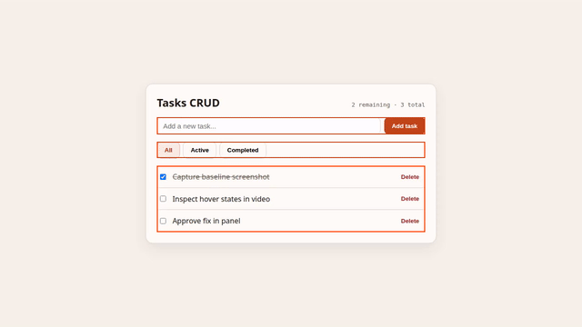

# Tasks CRUD (`examples/apps/crud-tasks`)

> Idioma: [English](README.md) | **Português (BR)**

Aplicação clássica de lista de tarefas (CRUD) demonstrando formulários, filtros por estado (`All` / `Active` / `Completed`), checkboxes, remoção de itens e estado vazio sem nenhuma instrumentação do Rupicola no código-fonte.

## Como rodar

```sh
python3 -m http.server 8080 --directory protocol/examples/apps/crud-tasks
```

Abra `http://127.0.0.1:8080` no navegador.

## Capturas geradas





- Vídeo do fluxo interativo (limpo): [walkthrough.mp4](media/walkthrough.mp4)
- Vídeo do fluxo interativo (anotado): [walkthrough-annotated.mp4](media/walkthrough-annotated.mp4)




