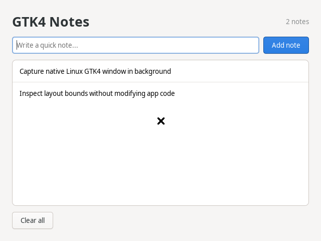

# GTK4 Notes (`examples/apps/gtk4-notes`)

> Language: **English** | [Português (BR)](README.pt-BR.md)

Native Linux desktop application built with **GTK 4** (`PyGObject`) demonstrating `Gtk.ApplicationWindow`, `Gtk.Entry`, `Gtk.Button`, and `Gtk.ListBox` with zero Rupicola code inside the application.

## How to run

```sh
python3 protocol/examples/apps/gtk4-notes/app.py
```

Run headless in the background using `Xvfb`:

```sh
Xvfb :99 -screen 0 1280x720x24 &
GDK_BACKEND=x11 DISPLAY=:99 python3 protocol/examples/apps/gtk4-notes/app.py
```

## Captured Media




- Background headless video capture (`Xvfb` + `ffmpeg x11grab`): [walkthrough.mp4](media/walkthrough.mp4)
