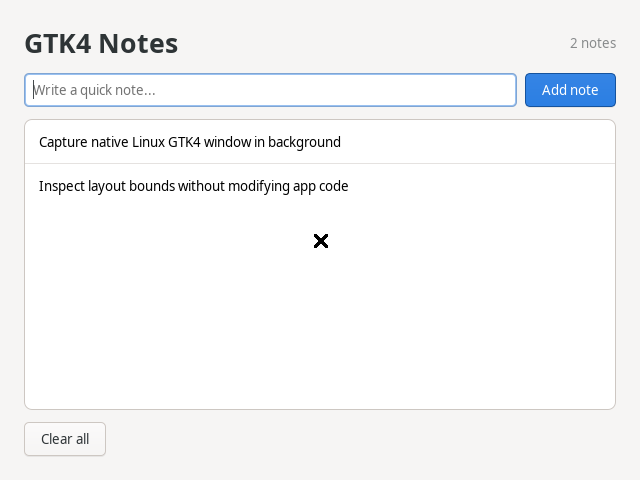

# GTK4 Notes (`examples/apps/gtk4-notes`)

> Idioma: [English](README.md) | **Português (BR)**

Aplicação desktop nativa Linux escrita em **Rust puro** linkando `libgtk-4` diretamente (zero crates externas e nenhum código do Rupicola dentro da aplicação).

## Como rodar

```sh
cargo run --manifest-path protocol/examples/apps/gtk4-notes/Cargo.toml
```

Rodar em background headless com `Xvfb`:

```sh
Xvfb :99 -screen 0 640x480x24 &
GSK_RENDERER=cairo GDK_BACKEND=x11 DISPLAY=:99 cargo run --manifest-path protocol/examples/apps/gtk4-notes/Cargo.toml
```

## Capturas geradas




- Vídeo capturado em background (`Xvfb` + `ffmpeg x11grab`): [walkthrough.mp4](media/walkthrough.mp4)
