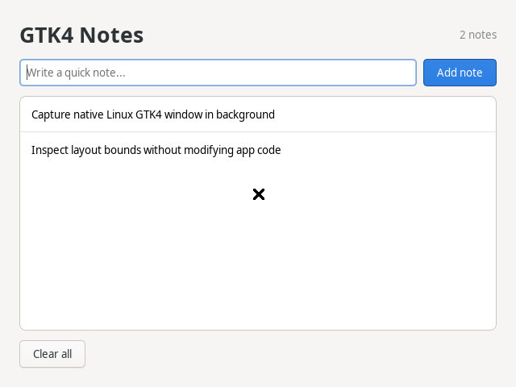
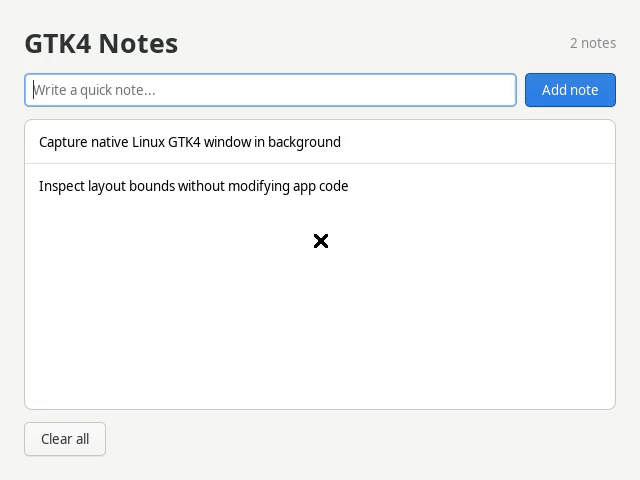
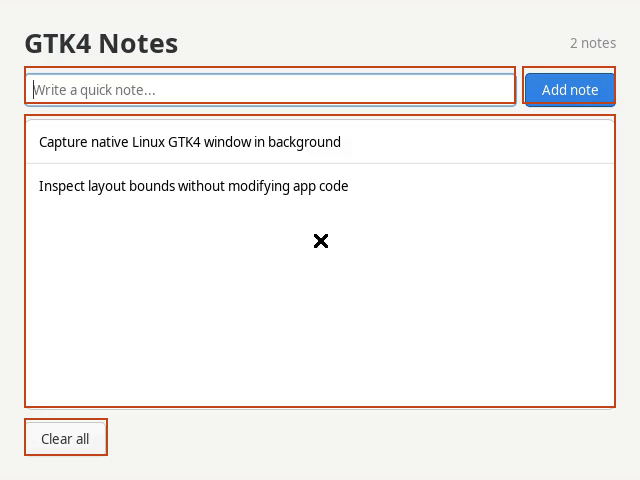

# GTK4 Notes (`examples/apps/medium/notes/gtk4`)


Native Linux desktop application written in **pure Rust** linking `libgtk-4` directly (zero external crates, zero Rupicola code inside the application).

## How to run

```sh
cargo run --manifest-path protocol/examples/apps/medium/notes/gtk4/Cargo.toml
```

Run headless in the background using `Xvfb`:

```sh
Xvfb :99 -screen 0 640x480x24 &
GSK_RENDERER=cairo GDK_BACKEND=x11 DISPLAY=:99 cargo run --manifest-path protocol/examples/apps/medium/notes/gtk4/Cargo.toml
```

## Captured Media







