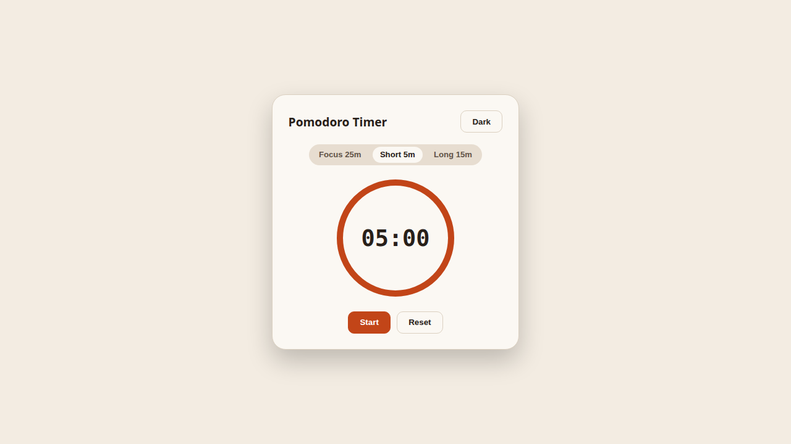
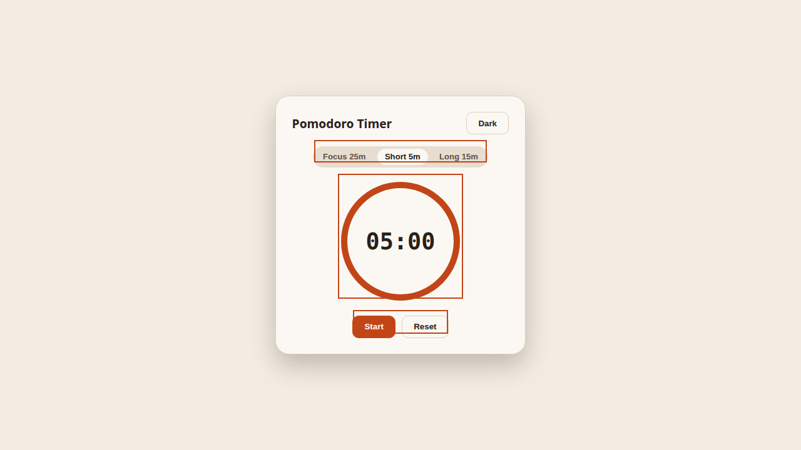
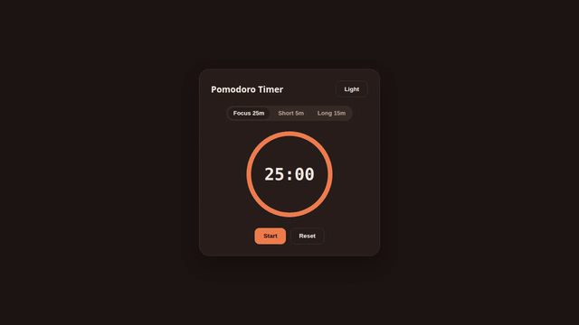
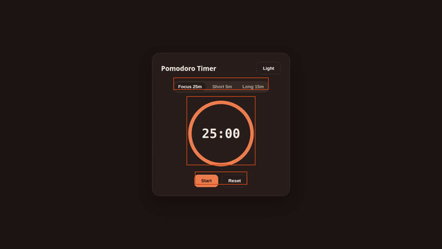

# Pomodoro Timer (`examples/apps/medium/pomodoro/html`)


Classic Pomodoro timer application demonstrating animated SVG progress (`stroke-dashoffset`), preset switching (`Focus` / `Short` / `Long`), timer state (`Start` / `Pause` / `Reset`), and light/dark theme toggling without any Rupicola instrumentation in the app source.

## How to run

```sh
python3 -m http.server 8081 --directory protocol/examples/apps/medium/pomodoro/html
```

Open `http://127.0.0.1:8081` in your browser.

## Captured Media









