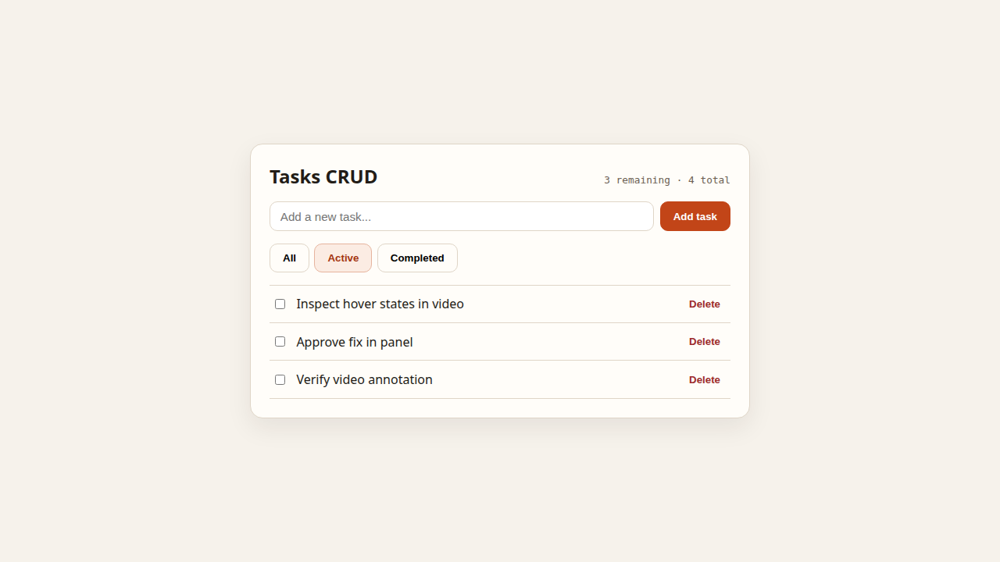
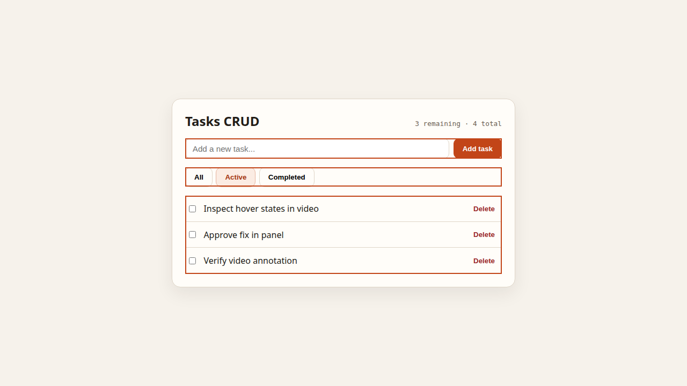
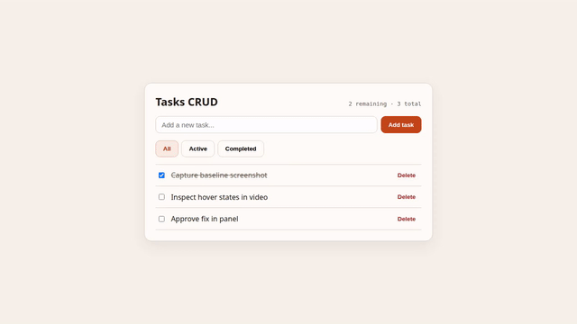
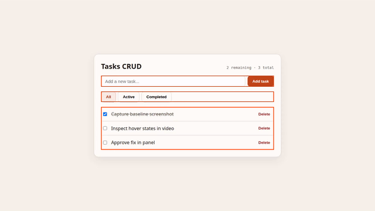

# Tasks CRUD (`examples/apps/medium/tasks/html`)


Classic task-list CRUD application demonstrating form submission, state filters (`All` / `Active` / `Completed`), checkboxes, item removal, and empty states without any Rupicola instrumentation in the app source.

## How to run

```sh
python3 -m http.server 8080 --directory protocol/examples/apps/medium/tasks/html
```

Open `http://127.0.0.1:8080` in your browser.

## Captured Media









