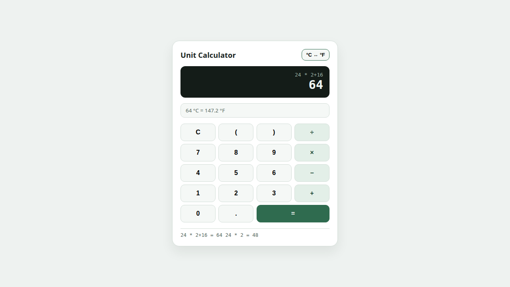
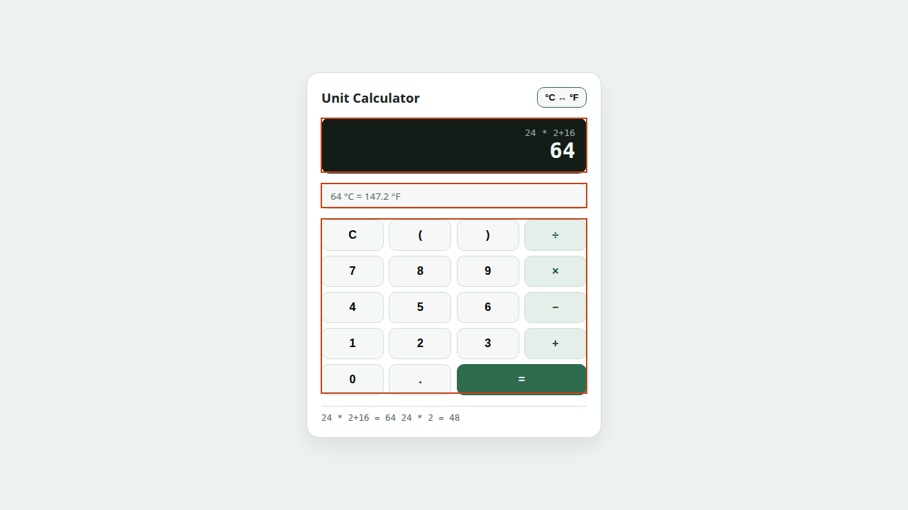
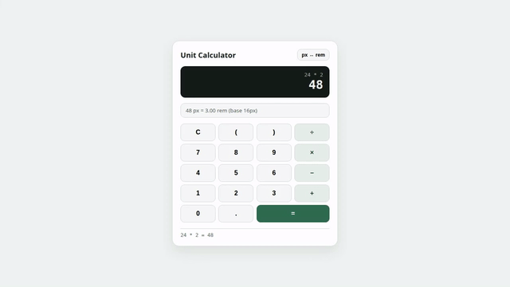
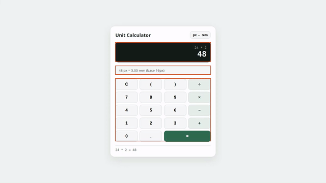

# Unit Calculator (`examples/apps/medium/unit-calculator/html`)


Classic calculator + unit converter (`px ↔ rem` and `°C ↔ °F`) demonstrating keypad grid layout, monospace display, expression evaluation, and operation history without any Rupicola instrumentation in the app source.

## How to run

```sh
python3 -m http.server 8082 --directory protocol/examples/apps/medium/unit-calculator/html
```

Open `http://127.0.0.1:8082` in your browser.

## Captured Media









