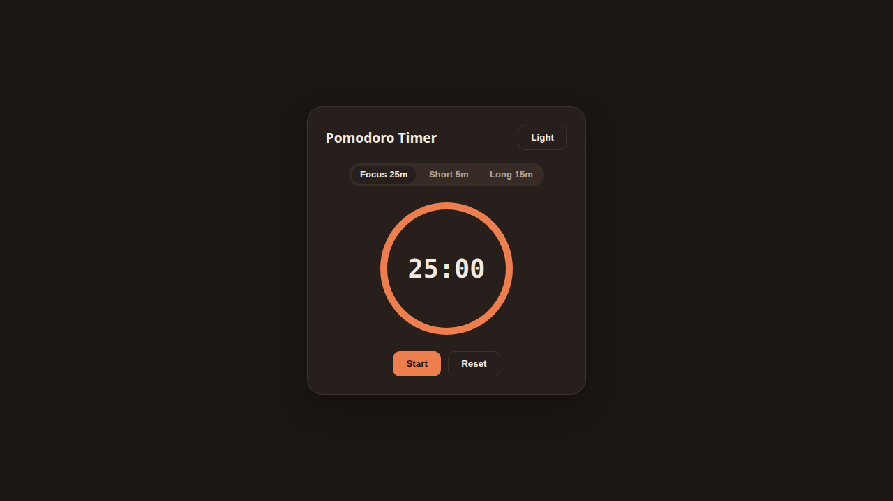

# Pomodoro Timer (`examples/pomodoro-timer`)

Aplicação clássica de timer Pomodoro demonstrando SVG animado (`stroke-dashoffset`), alternância de presets (`Focus` / `Short` / `Long`), estado temporal (`Start` / `Pause` / `Reset`) e troca de tema escuro/claro.

## Como rodar

```sh
python3 -m http.server 8081 --directory examples/pomodoro-timer
```

Abra `http://127.0.0.1:8081` no navegador.

## Capturas geradas




- Vídeo do fluxo interativo (timer em execução, troca de modo e tema): [walkthrough.mp4](media/walkthrough.mp4)
