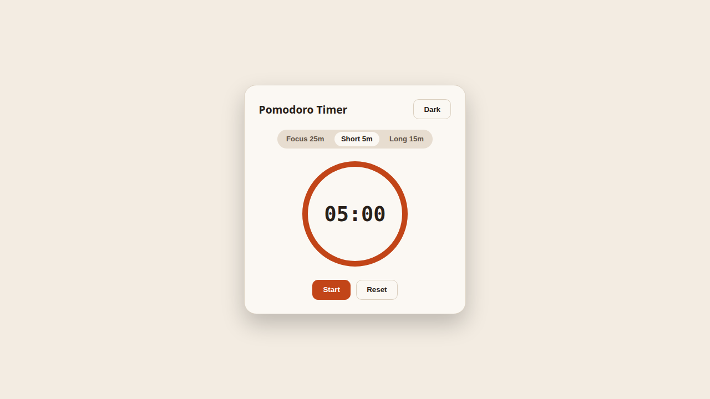
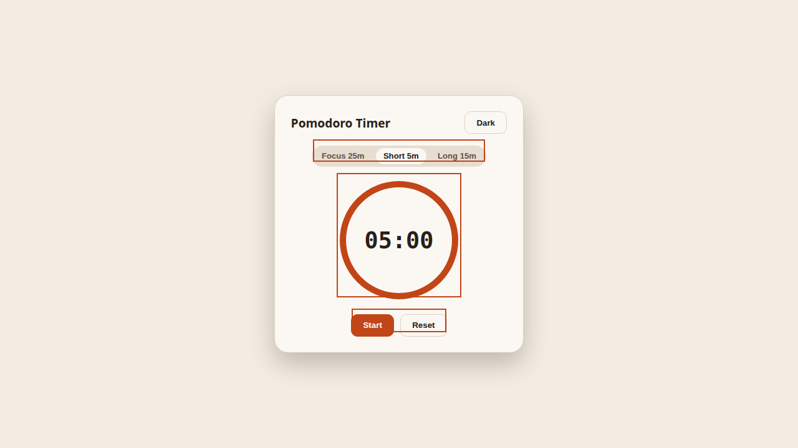
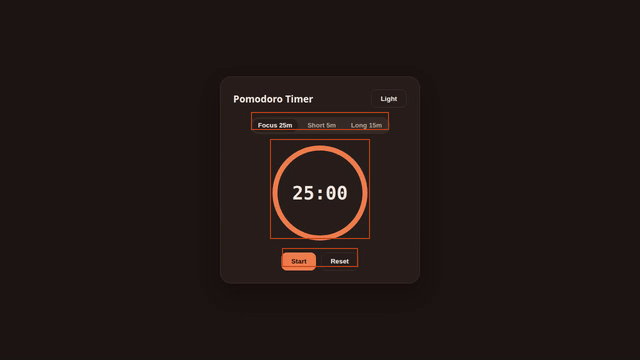

# Pomodoro Timer (`examples/apps/pomodoro-timer`)

> Idioma: [English](README.md) | **Português (BR)**

Aplicação clássica de timer Pomodoro demonstrando SVG animado (`stroke-dashoffset`), alternância de presets (`Focus` / `Short` / `Long`), estado temporal (`Start` / `Pause` / `Reset`) e troca de tema escuro/claro sem nenhuma instrumentação do Rupicola no código-fonte.

## Como rodar

```sh
python3 -m http.server 8081 --directory protocol/examples/apps/pomodoro-timer
```

Abra `http://127.0.0.1:8081` no navegador.

## Capturas geradas





- Vídeo do fluxo interativo (limpo): [walkthrough.mp4](media/walkthrough.mp4)
- Vídeo do fluxo interativo (anotado): [walkthrough-annotated.mp4](media/walkthrough-annotated.mp4)



