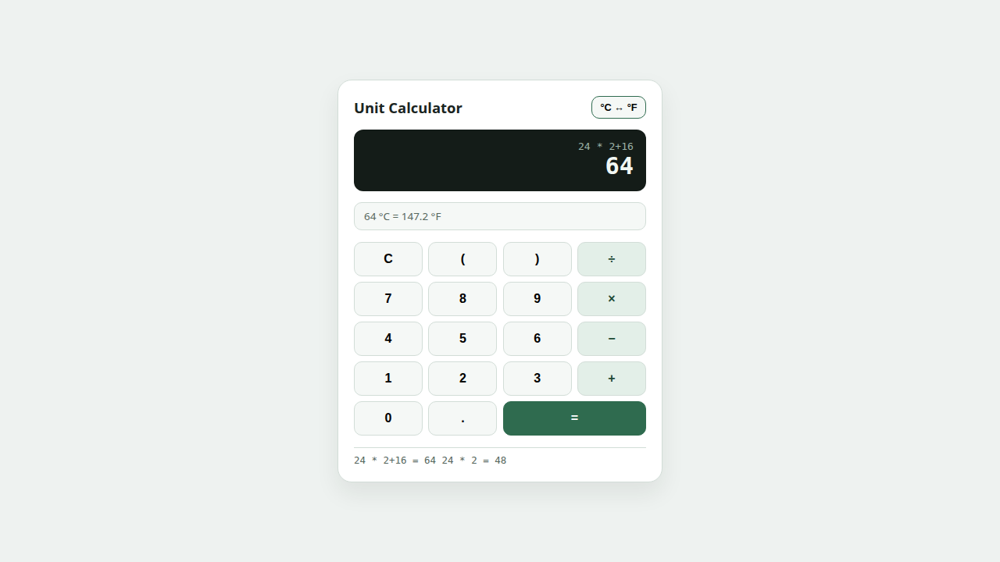
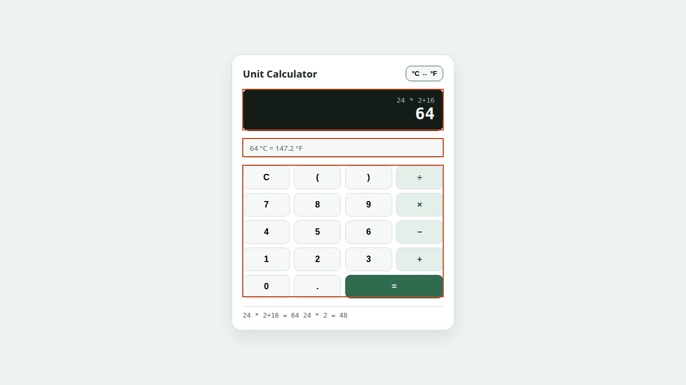
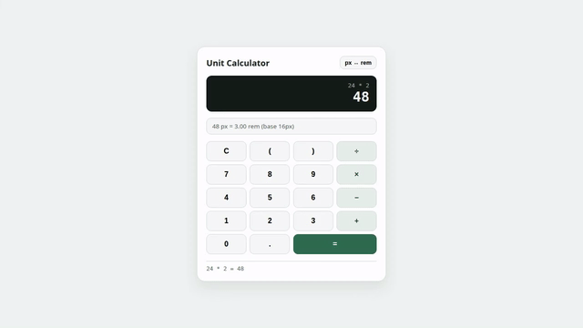
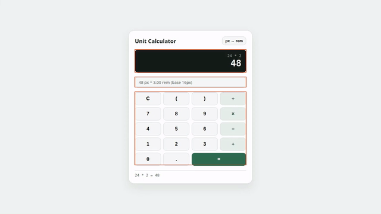

# Unit Calculator (`examples/apps/unit-calculator`)

> Language: **English** | [Português (BR)](README.pt-BR.md)

Classic calculator + unit converter (`px ↔ rem` and `°C ↔ °F`) demonstrating keypad grid layout, monospace display, expression evaluation, and operation history without any Rupicola instrumentation in the app source.

## How to run

```sh
python3 -m http.server 8082 --directory protocol/examples/apps/unit-calculator
```

Open `http://127.0.0.1:8082` in your browser.

## Captured Media





- Interactive walkthrough video (clean): [walkthrough.mp4](media/walkthrough.mp4)
- Interactive walkthrough video (annotated): [walkthrough-annotated.mp4](media/walkthrough-annotated.mp4)




