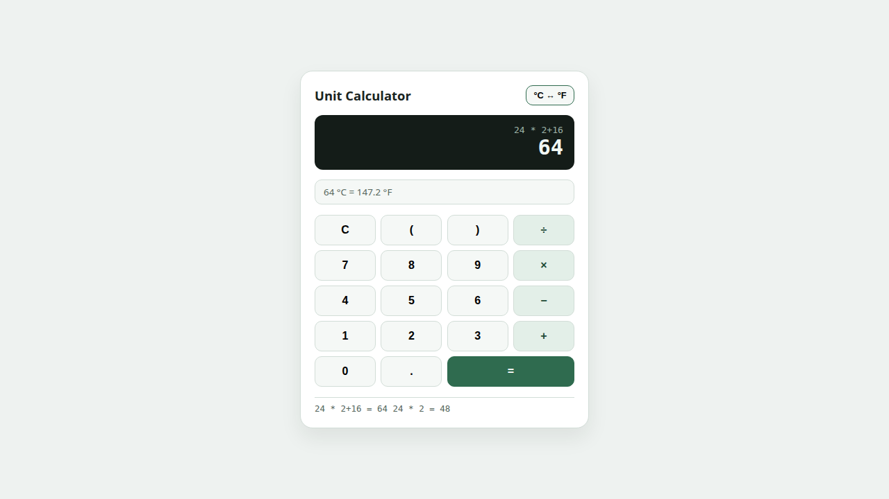
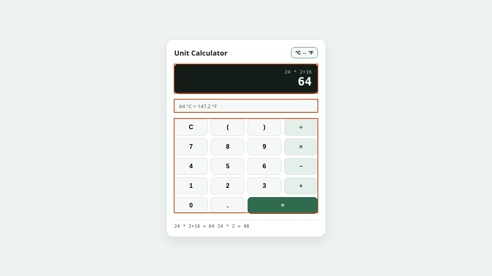
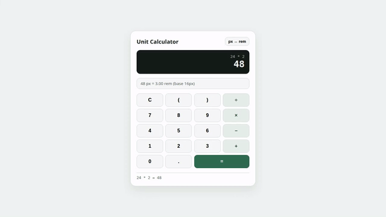
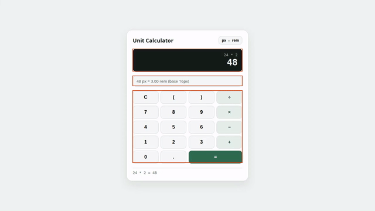

# Unit Calculator (`examples/apps/unit-calculator`)

> Idioma: [English](README.md) | **Português (BR)**

Aplicação clássica de calculadora + conversor de unidades (`px ↔ rem` e `°C ↔ °F`) demonstrando grid de botões, display monoespaçado, cálculo de expressão e histórico sem nenhuma instrumentação do Rupicola no código-fonte.

## Como rodar

```sh
python3 -m http.server 8082 --directory protocol/examples/apps/unit-calculator
```

Abra `http://127.0.0.1:8082` no navegador.

## Capturas geradas





- Vídeo do fluxo interativo (limpo): [walkthrough.mp4](media/walkthrough.mp4)
- Vídeo do fluxo interativo (anotado): [walkthrough-annotated.mp4](media/walkthrough-annotated.mp4)




